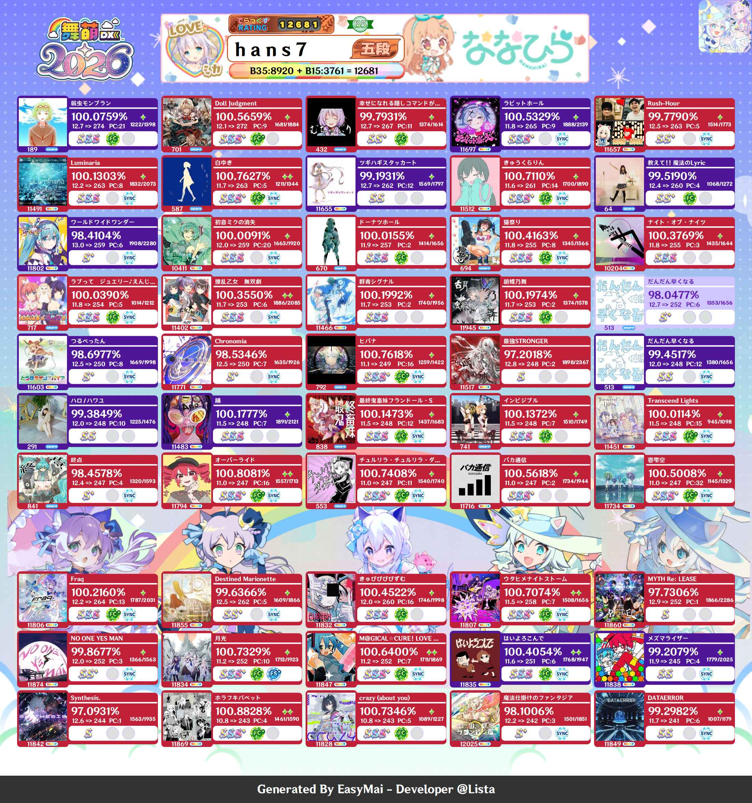

## Hi there 👋 I am Hans774882968, a passionate enthusiast of code 🔥

🌲 If we have no choice but to solve STEM puzzles, why not let them flourish in our dreams?

## Find Me on Social Medias

## ACM Career

I was an ACMer during my college years. Here are some of my achievements:

TODO: Hans Codeforces Stats

## Entertainment

I'm a maimai player currently:

my b50:

